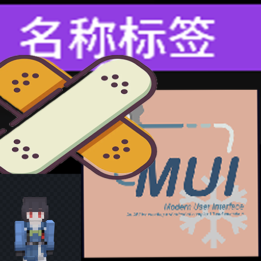

# NametagMuiFix

Meteor Client + Modern UI nametag anchoring compatibility fix.

- Jar: NametagMuiFix-1.21.11-v1.0.jar
- Author: hankli22
- Target: Minecraft 1.21.11, Meteor Client 1.21.11-86
- Environment: client only

## Problem

Meteor Client's NametagUtils computes its 2D anchor with:

    windowScale = mc.getWindow().calculateScale(1, false);

Vanilla returns 1 for this call. Modern UI overrides Window.calculateScale()
with its own GUI-scale calculation (minimum scale 2), so Meteor receives 2+
and divides the projected framebuffer coordinates by the wrong value. The
nametag is no longer attached to the entity and appears to fly around as the
camera rotates.

## Fix

The addon injects at the end of NametagUtils.onRender() and restores:

    windowScale = 1.0

This is the exact value vanilla returns for calculateScale(1, false); the
rest of Meteor's projection/pose pipeline is untouched.

It does not change Modern UI GUI scale, does not touch text rendering, and
does not depend on any other mod.

## Install

Drop the jar into .minecraft/mods together with Meteor Client 1.21.11-86 and
Modern UI for 1.21.11. No Fabric API dependency is required.

## Build

    ./gradlew build

The exact Meteor Client 1.21.11 build 86 snapshot is resolved from
https://maven.meteordev.org/snapshots and is compile-only; it is not bundled
into the addon jar.
